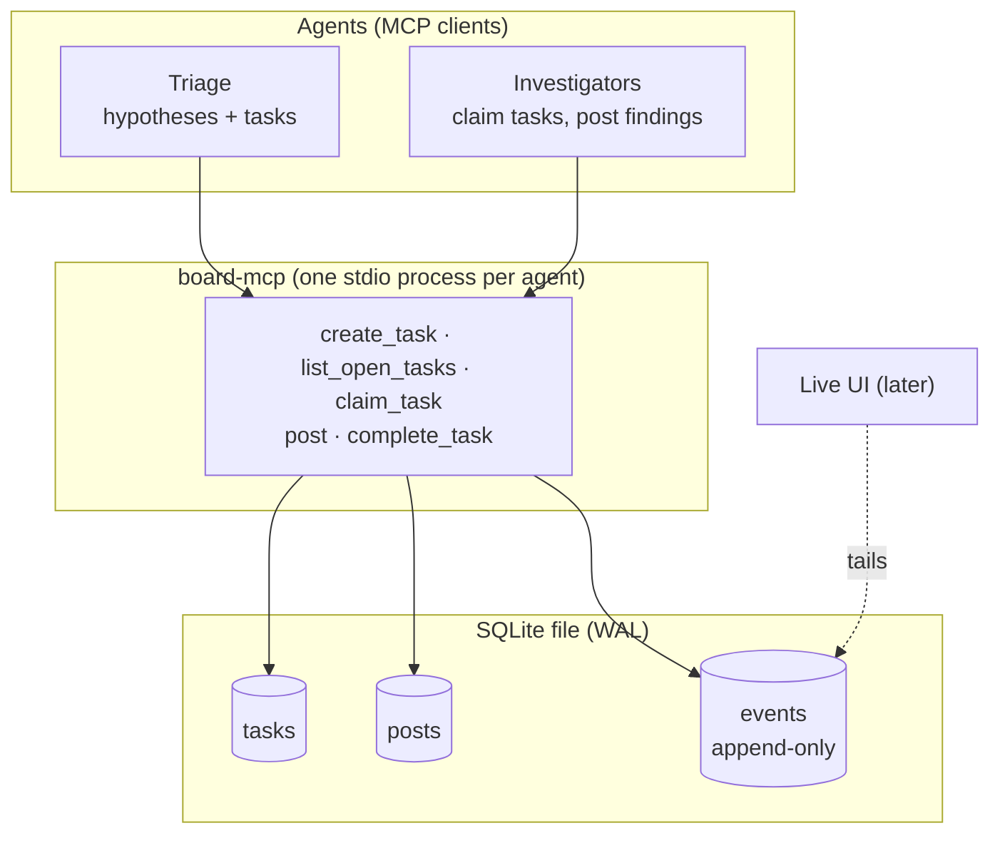

# k8s-war-room

A multi-agent Kubernetes incident-response system. Specialist agents investigate a broken pod together, and **they never
call each other**: every message goes through a shared board. Tools come from MCP servers, runbooks are loaded as skills
only when relevant, and the orchestration loop is hand-written, with no agent framework.

> **Status: Milestone 1 of 5.** The board, the `board-mcp` server, and two scripted (no-LLM) agents. No Kubernetes and no
> model yet. See [Milestones](#milestones).

## Architecture



The agents on the left of the diagram have no reference to each other. Triage writes tasks; an investigator that happens
to be free claims one. Adding a second investigator, or replacing one with an LLM-driven agent, changes nothing about
the others.

### The board (`src/board`)

| Table    | Holds                                                                                                   |
| -------- | ------------------------------------------------------------------------------------------------------- |
| `tasks`  | `id, type, status (open/claimed/done/failed), claimed_by, parent_id, input, result`: mutable work items |
| `posts`  | `task_id, agent, kind (finding/hypothesis/question/decision), content, evidence`: what agents say       |
| `events` | Append-only log of every state change: created, claimed, posted, completed                              |

### board-mcp (`src/mcp`)

Five tools, which are the whole interface agents have to shared state: `create_task`, `list_open_tasks`, `claim_task`,
`post`, `complete_task`. Each agent spawns its own server process over stdio, so each has its own SQLite connection to
the same file.

## Design decisions

- **A board instead of agent-to-agent calls.** Agents that call each other need to know who exists, what they can do,
  and what to do when one is down. With a board, an agent needs only the board's contract. It also makes the system
  inspectable: the whole incident is a table you can read, and replaying it is replaying the event log.
- **`claim_task` is one conditional `UPDATE`.** `UPDATE tasks SET status='claimed', claimed_by=? WHERE id=? AND
status='open'`, then check how many rows changed. Two agents can both _see_ a task as open, but the database applies
  their updates one at a time and the second matches nothing. There is no read-then-write gap, which is the usual bug
  in hand-rolled claim logic. The loser gets `{claimed: false, reason}` as a normal result, not an error, because
  losing a race is expected and an LLM should simply pick another task.
- **State change and event commit together.** Every mutation runs in a `BEGIN IMMEDIATE` transaction that writes the
  change and its event row, so the log can never disagree with the tables.
- **Invariants live in the database, not just the code.** `CHECK` constraints enforce the status machine (including "an
  open task has no owner"), and triggers make `events` refuse `UPDATE` and `DELETE`. A bug in an agent or in `Board`
  can't corrupt them; the tests prove it with raw SQL that bypasses the class.
- **Ownership is enforced on completion.** Only the agent holding the claim can complete a task. Anyone can post,
  because a Reviewer needs to comment on a task it doesn't own. Caller mistakes come back as MCP tool errors with a
  readable message, so a model can correct itself.
- **SQLite over a server database.** One file, no service to run, and still correct under concurrent processes thanks
  to WAL mode and a write lock taken up front. Uses Node's built-in `node:sqlite`, so there is no native module to
  compile. It is still flagged experimental in Node 22, hence the `--disable-warning` flag when spawning.
- **No build step.** Node 22.19+ runs TypeScript directly by stripping types, so source files import `./x.ts` and
  `erasableSyntaxOnly` keeps the code to syntax that can be stripped. `tsc` is used only to typecheck.
- **Agent identity is an argument, for now.** Tools take an `agent` name and trust it. That is fine while all agents are
  ours; a later milestone can bind the name to the server process (one `board-mcp` per agent already makes that easy).

## Run it

Requires Node 22.19+ and pnpm.

```bash
pnpm install
pnpm demo
```

The demo starts three `board-mcp` processes, has Triage open an incident, then lets two investigators race for the
tasks. You will see each task claimed by exactly one of them, and the event log shows the interleaving.

To run the agents as separate processes yourself (use one terminal each):

```bash
node --disable-warning=ExperimentalWarning src/cli.ts triage /tmp/board.db
node --disable-warning=ExperimentalWarning src/cli.ts investigator /tmp/board.db investigator-1
node --disable-warning=ExperimentalWarning src/cli.ts investigator /tmp/board.db investigator-2
node --disable-warning=ExperimentalWarning src/cli.ts show /tmp/board.db
```

## Test

```bash
pnpm typecheck && pnpm test
```

The tests cover the lifecycle, ownership rules, the event log and schema guarantees, and the claim race at three
levels: two connections in one process, many tasks across many connections, and two real `board-mcp` processes firing
`claim_task` at the same instant.

## Layout

```
src/board/     schema, Board class (the only code that touches SQLite)
src/mcp/       board-mcp server, stdio entry point, typed client wrapper
src/agents/    fake triage and investigator (scripted, no LLM)
src/cli.ts     demo, per-agent runners, board dump
skills/        runbooks loaded on demand (placeholder until Milestone 2)
test/          vitest
```

## Milestones

1. **Board + board-mcp, two fake agents** (done)
2. k8s-mcp (read-only), Triage and Logs agents with an LLM, first skills
3. Web agent + live UI
4. Remediator, Reviewer, approval gate for writes
5. Chaos scenarios + eval harness
